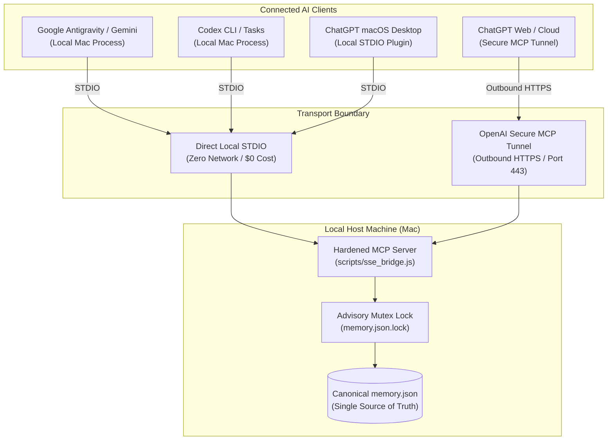

# Shared Cognitive Memory — Transport Architecture

> **Canonical Transport Specification:**  
> `https://github.com/PeterJFrancoIII/Shared-Cognitive-Memory-for-Cross-Platform-AI-Conversations/tree/main/docs/LOCAL_TRANSPORT.md`  
> Directives Reference: `SHARED_MEMORY_AGENT_RULES.md`, `MCP_SPEC.md`  
> **Mandatory Citation Going Forward:**  
> `Shared Memory MCP Rules: https://github.com/PeterJFrancoIII/Shared-Cognitive-Memory-for-Cross-Platform-AI-Conversations/tree/main/docs/SHARED_MEMORY_AGENT_RULES.md`

---

## 1. Preserved Golden Master Baseline

This architectural specification standardizes the transport topology for the Shared Cognitive Memory network. It permanently eliminates public reverse tunnels (ngrok) while preserving all golden master invariants:

* **Single Source of Truth:** Exactly one canonical local graph file (`memory.json`) on the host machine.
* **Hardened 8-Tool Contract:** Exposes exactly 6 graph operations (`open_nodes`, `search_nodes`, `read_graph`, `add_observations`, `create_entities`, `create_relations`) plus 2 restricted source inspection tools (`read_shared_memory_file`, `list_shared_memory_files`).
* **Strict Security Invariants:** Zero delete operations, zero arbitrary shell/filesystem execution, fail-closed access control on sensitive paths, and zero plaintext credentials in repository or graph.

---

## 2. Supported Transport Topology

---

## 3. Detailed Transport Configurations

### A. Direct Local STDIO (Primary, Zero Cost, Zero Ingress)
- **Invocation:** `node scripts/sse_bridge.js --stdio`
- **Clients:** Google Antigravity IDE, Gemini CLI, OpenAI Codex CLI (`~/.codex/config.toml`), and ChatGPT macOS Desktop local plugin.
- **Characteristics:**
  - Standard input/output communication.
  - Zero network latency, zero listening ports.
  - Complete immunity to network outages or bandwidth quotas.
  - 100% free ($0 additional infrastructure cost).

### B. OpenAI Secure MCP Tunnel (Cloud / Web ChatGPT Client)
- **Invocation:** Managed daemon `tunnel-client` on local host.
- **Clients:** ChatGPT Web (`chatgpt.com`), ChatGPT iOS / Android apps.
- **Characteristics:**
  - Establishes an encrypted **outbound-only** HTTPS tunnel (port 443) to OpenAI's gateway.
  - **Zero inbound firewall ports opened:** No router port forwards, no public IP exposure, no ngrok URL.
  - Proxies tool calls directly to the local authenticated `sse_bridge.js` runtime.
  - Managed via dedicated host runtime (e.g. MediaServer2).

### C. Supervised Loopback HTTP Bridge (Local Service Fallback)
- **Invocation:** `node scripts/sse_bridge.js 8080`
- **Interface:** Binds strictly to loopback interface `127.0.0.1:8080`.
- **Authentication:** Mandatory HTTP header `Authorization: Bearer <TOKEN>` read from local protected file `~/.shared_memory_tunnel_token` (mode `0600`).
- **Supervision:** Managed by macOS `launchd` service `com.sharedmemory.supervisor`.

---

## 4. Multi-Agent Concurrency & Mutex Safety

When multiple AI assistants access the canonical graph simultaneously, corruption is prevented by:
1. **Advisory File Lock (`memory.json.lock`):**
   - Exclusive lock created via `fs.openSync(lockPath, 'wx')` (`O_CREAT | O_EXCL`).
   - If locked, retries with exponential jitter backoff for up to 10 seconds.
   - Stale lock detection: Checks locking PID. If dead (`kill(pid, 0)` returns `ESRCH`) or older than 30s, lock is automatically broken.
2. **Atomic Write Pipeline:**
   - Changes are serialized to a temporary file: `.${basename}.${pid}.${hex}.tmp`.
   - Forces hardware disk flush via `fs.fsyncSync(fd)`.
   - Atomically renames temporary file over `memory.json` using POSIX atomic `fs.renameSync()`.
3. **Automated Verification:**
   - Verified by concurrent writer stress test in `tests/mcp_runtime.test.js` (22/22 tests passing).
