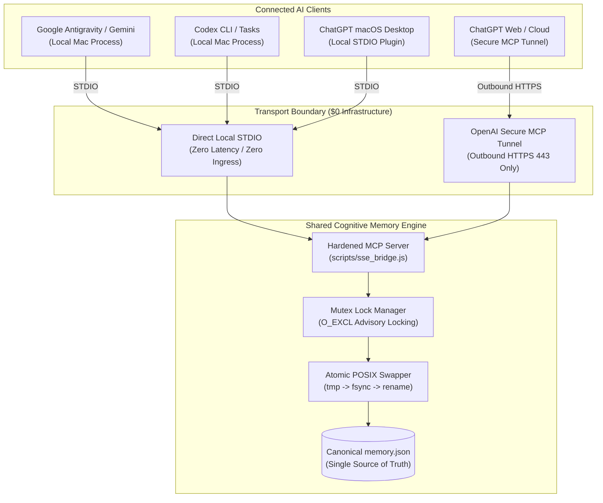

# Shared Cognitive Memory for Cross Platform AI Conversations

[](tests/mcp_runtime.test.js)
[](docs/MCP_SPEC.md)
[](LICENSE)
[-green.svg)](docs/LOCAL_TRANSPORT.md)
[](docs/SECURITY.md)

> **The Sovereign, Cross-Platform Knowledge Graph & Inter-Agent Coordination Bus for AI Assistants.**  
> Seamlessly share persistent memory, execute context handoffs, and collaborate across **Google Gemini**, **OpenAI ChatGPT**, **Antigravity IDE**, **Codex**, and **Anthropic Claude**.

---

## 🌟 Why Shared Cognitive Memory?

Today's frontier AI models operate in isolated context silos:
* When you switch from **Antigravity** to **ChatGPT**, you lose your project history.
* When tasks require a specialist agent, you must manually copy-paste handoff notes and terminal outputs.
* Cloud-hosted vector databases create vendor lock-in, recurring infrastructure costs, and data privacy risks.

**Shared Cognitive Memory** solves this by establishing a **single, local, user-owned knowledge graph** on your machine, accessible across all your AI assistants through the **Model Context Protocol (MCP)**.



---

## 🚀 Quickstart (60 Seconds)

### 1. Prerequisites
- **Node.js** v20.0.0 or higher (Pure Node.js standard library — **zero external npm dependencies**).

### 2. Verify Runtime & Regression Suite
Clone the repository and run the test suite:
```bash
git clone https://github.com/PeterJFrancoIII/Shared-Cognitive-Memory-for-Cross-Platform-AI-Conversations.git
cd Shared-Cognitive-Memory-for-Cross-Platform-AI-Conversations
npm test
```
*Expected Output:* **22/22 tests passing** (verifying tool execution, concurrency locking, atomic tempfile swaps, credential scrubbing, and fail-closed security).

### 3. Connect Your Agents
- **Google Antigravity / Gemini:** Follow [`docs/SETUP_GEMINI.md`](docs/SETUP_GEMINI.md).
- **OpenAI ChatGPT Desktop / Web:** Follow [`docs/SETUP_CHATGPT.md`](docs/SETUP_CHATGPT.md).

---

## 🛡️ Core Invariants

1. **One Canonical Brain:** Exactly one private `memory.json` on the local host. No secondary stores, duplicate databases, or shadow graphs.
2. **Deterministic Session Isolation:** Every chat thread operates within its explicit session node (`Session_<Agent>_<Project>_<YYYYMMDD-HHMM>`).
3. **One Coordination Bus:** `InterAgent_Dialogue_Channel` is the sole authorized inter-agent message broker.
4. **Selective Context Retrieval:** Standard retrieval uses `search_nodes` → `open_nodes`. Unbounded graph dumps (`read_graph`) are restricted to justified debug/recovery workflows.
5. **Strict Secret Hygiene:** No API keys, passwords, bearer tokens, or private runtime logs may be committed to Git or stored in `memory.json`.
6. **Multi-Agent Transactional Safety:** Advisory mutex file locking (`memory.json.lock` using `O_EXCL` with automatic stale-lock recovery) and POSIX atomic tempfile renaming (`fsyncSync` + `renameSync`).

---

## 🛠️ The 8 Hardened MCP Tools

The server implements Model Context Protocol version `2025-06-18` exposing **exactly 8 authorized capabilities**:

| Category | Tool | Type | Description |
| :--- | :--- | :--- | :--- |
| **Cognitive Graph** | `open_nodes` | Read | Retrieve specific entities and their connected relations by name. |
| **Cognitive Graph** | `search_nodes` | Read | Selective search matching entity names, types, or observation text. |
| **Cognitive Graph** | `read_graph` | Read (Gated) | Exceptional full graph dump; requires `purpose` (`debug`\|`recovery`) and concrete `reason`. |
| **Cognitive Graph** | `add_observations` | Write | Append verified observations to an existing entity under lock. |
| **Cognitive Graph** | `create_entities` | Write | Create new entities with name, entityType, and initial observations. |
| **Cognitive Graph** | `create_relations` | Write | Create directed semantic relations between existing entities. |
| **Source Inspection** | `read_shared_memory_file` | Read | Safely inspect allowlisted project files. Rejects traversal and private data. |
| **Source Inspection** | `list_shared_memory_files` | Read | Enumerate all allowlisted project files available for inspection. |

*Notice: There are intentionally **zero delete tools**, zero arbitrary shell execution tools, and zero arbitrary filesystem write APIs.*

---

## 🤝 Inter-Agent Communication Bus

Agents exchange coordination directives and handoffs through the dedicated entity `InterAgent_Dialogue_Channel`.

### Message Header Specification
Every observation posted to the dialogue channel must follow this format:
```text
[TIMESTAMP | SOURCE_AGENT -> DESTINATION_AGENT | MSG:<unique-id> | SESSION:<canonical-session-id>]
STATUS: <Current execution status>
ACTION: <Actionable directive or acknowledgment>
PROVENANCE: Shared Memory: <Session/Entity> | MSG:<prior-msg-id>
NEXT: <Recommended next steps>
```

### Provenance Citation Rule
Whenever an agent acts upon or incorporates work produced by another agent, it MUST cite the exact origin:
```text
Shared Memory: <SESSION/ENTITY> | MSG:<message-id>
```

---

## 📚 Documentation Directory

| Document | Purpose |
| :--- | :--- |
| [`docs/SHARED_MEMORY_AGENT_RULES.md`](docs/SHARED_MEMORY_AGENT_RULES.md) | **Mandatory Universal Agent Rules** — Authoritative operating specification for all AI assistants. |
| [`docs/AGENT_BOOTSTRAP.md`](docs/AGENT_BOOTSTRAP.md) | **Agent Startup Procedure** — 6-step lifecycle for newly initialized agents. |
| [`docs/MCP_SPEC.md`](docs/MCP_SPEC.md) | **MCP Protocol Specification** — Schemas, error handling, protocol versions, and runtime contracts. |
| [`docs/ARCHITECTURE.md`](docs/ARCHITECTURE.md) | **System Architecture** — Storage engine, concurrency mechanics, and JSONL data model. |
| [`docs/LOCAL_TRANSPORT.md`](docs/LOCAL_TRANSPORT.md) | **Transport Specification** — Direct STDIO, loopback HTTP gateway, and Secure MCP Tunnel. |
| [`docs/SECURITY.md`](docs/SECURITY.md) | **Security & Secret Hygiene** — Threat model, fail-closed boundaries, and abstract credentials. |
| [`docs/GOLDEN_MASTER.md`](docs/GOLDEN_MASTER.md) | **Golden Master Registry** — Change control, verified release baselines, and historical lineage. |
| [`docs/CHANGELOG.md`](docs/CHANGELOG.md) | **Release Changelog** — Historical evolution from initial baseline to dedicated repository. |
| [`docs/SETUP_GEMINI.md`](docs/SETUP_GEMINI.md) | **Gemini & Antigravity Setup** — Client configuration guide. |
| [`docs/SETUP_CHATGPT.md`](docs/SETUP_CHATGPT.md) | **ChatGPT & Codex Setup** — Local Desktop Plugin and Secure Tunnel configuration guide. |

---

## ⚖️ License & Provenance

* **Author:** Peter J. Franco III
* **License:** [MIT License](LICENSE)
* **Historical Provenance:** Decoupled from the Terminal-to-Gemini Bridge application (`PeterJFrancoIII/Gemini_To_Terminal_CLI_Remote_Agent`) on October 13, 2026, establishing an independent home for multi-agent shared cognitive memory research.
