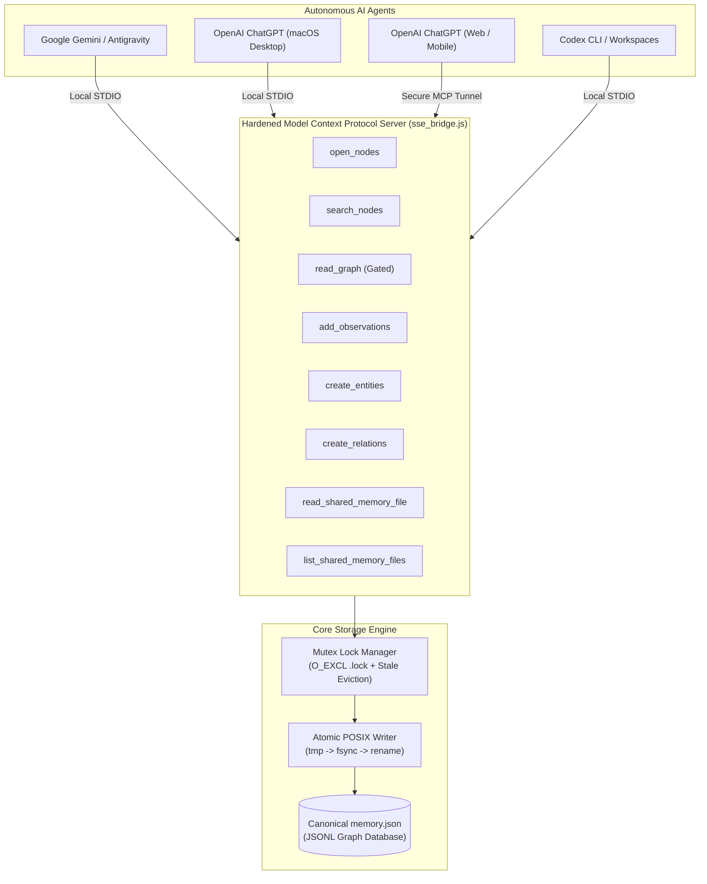

# System Architecture — Shared Cognitive Memory

> **Canonical System Architecture:**  
> `https://github.com/PeterJFrancoIII/Shared-Cognitive-Memory-for-Cross-Platform-AI-Conversations/tree/main/docs/ARCHITECTURE.md`  
> Directives Reference: `SHARED_MEMORY_AGENT_RULES.md`, `MCP_SPEC.md`, `LOCAL_TRANSPORT.md`

---

## 1. Problem Statement & Motivation

Modern AI agents (Google Gemini, OpenAI ChatGPT, Anthropic Claude, Codex, GitHub Copilot) operate in isolated memory silos:
1. **Platform Amnesia:** Context developed in Antigravity or Gemini is unavailable to ChatGPT, and vice versa.
2. **Loss of Handoffs:** Complex multi-step engineering projects require humans to manually copy-paste prompts, error logs, and decisions between chats.
3. **Third-Party Lock-in:** Cloud-hosted memory solutions bind users to proprietary platforms, risk privacy leaks, and introduce external network failure points.

**Shared Cognitive Memory** solves this by establishing a **single, local, sovereign knowledge graph** controlled entirely by the user, accessed via the open **Model Context Protocol (MCP)**.

---

## 2. Architectural Blueprint



---

## 3. Data Model

The knowledge graph is persisted in line-delimited JSON (JSONL). This guarantees streaming efficiency, atomic append capabilities, and resilient line-by-line parsing.

### Entities
An entity represents an agent session, a project concept, an external system, or the central dialogue bus:
```json
{
  "type": "entity",
  "name": "Session_Antigravity_Shared_Cognitive_Memory_20261013-0200",
  "entityType": "Session_Working_Memory",
  "observations": [
    "[2026-10-13 02:00 EDT | Antigravity]: Completed dedicated repository setup."
  ]
}
```

### Relations
Relations represent directed, semantic links between entities:
```json
{
  "type": "relation",
  "from": "Google_Antigravity_IDE",
  "to": "InterAgent_Dialogue_Channel",
  "relationType": "broadcasts_to"
}
```

---

## 4. Inter-Agent Communication Bus

The system designates **one** universal inter-agent message channel:
`InterAgent_Dialogue_Channel`

### Standard Header Specification
All messages posted to the channel must include:
```text
[TIMESTAMP | SOURCE_AGENT -> DESTINATION_AGENT | MSG:<unique-id> | SESSION:<canonical-session-id>]
STATUS: <Current status>
ACTION: <Actionable directive or ACK>
PROVENANCE: Shared Memory: <Session/Entity> | MSG:<prior-msg-id>
```

### Coordination vs. Canonical Truth
Inter-agent messages represent **coordination evidence**, not verified truth. Incoming agents must empirically verify claims (e.g., checking configuration files, running test suites) before promoting decisions to durable project entities.

---

## 5. Mutex & Concurrency Mechanics

Because multiple AI assistants may execute concurrently:
1. **Advisory Lockfile (`memory.json.lock`):**
   - Opened using flags `wx` (`O_CREAT | O_EXCL`).
   - Writes write PID metadata into the lock file.
   - If locked, retries with backoff up to 10 seconds.
   - Stale lock resolution: If lock timestamp is > 30s or PID is dead (`kill(pid, 0)` returns `ESRCH`), the stale lock is safely broken.
2. **Atomic Write Replacement:**
   - Modified graph is serialized to a unique temp file: `.${basename}.${pid}.${crypto.randomBytes(4).toString('hex')}.tmp`.
   - Flushes unwritten disk buffers with `fs.fsyncSync(fd)`.
   - Replaces `memory.json` using POSIX atomic `fs.renameSync()`.
   - Ensures that readers never observe partially written JSON.
